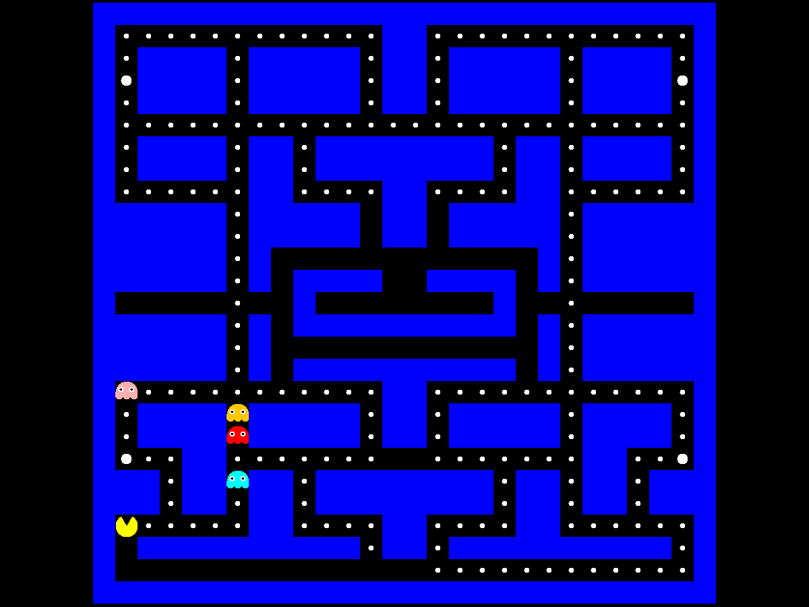

# PacMan — 搜尋演算法 AI 幽靈

用 Java Swing 實作的小精靈遊戲。四隻幽靈的移動完全由**搜尋演算法**決定，可以在啟動時切換 DFS、BFS、IDDFS、UCS、A*，比較不同演算法追擊玩家的效果。



> 題目來自大學人工智慧課程，課程內容採用 [UC Berkeley CS188 Pac-Man Projects](https://inst.eecs.berkeley.edu/~cs188/)。原作業用 Python 完成，這個專案是我用 Java 從零重寫成可遊玩的版本，並自行設計幽靈的追擊與逃跑邏輯。迷宮配置參考 CS188 的 `originalClassic` 版圖。

## 功能

- 方向鍵操作小精靈，`Esc` 暫停 / 繼續
- 吃到大力丸後幽靈進入**驚嚇模式**：變藍色並逃離玩家，快結束時會閃爍提示
- 驚嚇模式下吃掉幽靈，幽靈會以較快速度返回出生點後復活
- 碰到正常狀態的幽靈遊戲結束
- `-debug` 模式會在終端機輸出每一幀玩家位置、每隻幽靈的目標點與搜尋出的路徑

## 搜尋演算法

所有演算法都在 [`Search.java`](src/Algorithms/Search.java)，在格子迷宮上搜尋從幽靈到目標點的路徑，幽靈每幀朝路徑的第一步移動。

| 演算法 | 實作重點 |
| --- | --- |
| **DFS** | 以 stack 展開，找到的路徑不保證最短，幽靈常繞遠路 |
| **BFS** | 以 queue 逐層展開，保證步數最短 |
| **IDDFS** | 逐步放寬深度限制的 DFS（DLS），兼顧最短路徑與 DFS 的記憶體用量 |
| **UCS** | 以 priority queue 依累積成本展開；經過大力丸的格子成本較高（10 vs 1），幽靈會傾向避開 |
| **A\*** | UCS 加上曼哈頓距離作為啟發函式，展開節點較少（預設） |

另外還有兩個輔助用的 BFS：

- **距離表**：以玩家為起點 BFS，算出迷宮每一格到玩家的最短距離，驚嚇模式的幽靈依此選擇離玩家最遠的方向
- **最近有效格**：當目標點落在牆內或迷宮外時，以 BFS 修正到最近的可走格子

## 幽靈 AI

四隻幽靈各有不同的「瞄準點」，再交給搜尋演算法找路徑，參考原版小精靈的設計：

| 幽靈 | 顏色 | 追擊方式 |
| --- | --- | --- |
| Blinky | 紅 | 直接瞄準玩家 |
| Pinky | 粉 | 瞄準玩家面向前方 4 格（距離過近時直接瞄準玩家） |
| Inky | 青 | 以玩家前方 2 格為中心，瞄準 Blinky 位置的對稱點，和 Blinky 形成夾擊 |
| Clyde | 橘 | 距離玩家 8 格以上時追擊，太近時改往迷宮左下角跑 |

狀態切換：

```
Normal ──吃到大力丸──▶ Scared ──被吃──▶ Dead ──回到出生點──▶ Normal
                         │
                         └──時間到──▶ Normal
```

## 技術

- Java 21（使用 `List.getFirst()` 等 Java 21 API）
- Swing / AWT 繪圖，無外部函式庫
- 遊戲邏輯與繪圖分成兩條執行緒，以固定 FPS 更新，共用狀態以 `synchronized` 保護

## 執行方式

需要 **JDK 21 以上**。

```bash
javac -encoding UTF-8 -d bin $(find src -name "*.java")
java -cp bin Panel.MainForm
```

也可以用 Eclipse 直接匯入專案（File → Import → Existing Projects into Workspace）。

### 啟動參數

| 參數 | 說明 |
| --- | --- |
| （無） | 使用 A* |
| `-dfs` / `-bfs` / `-iddfs` / `-ucs` | 切換幽靈使用的搜尋演算法 |
| `-debug` | 在終端機輸出搜尋過程 |

例如：

```bash
java -cp bin Panel.MainForm -bfs -debug
```

## 專案結構

```
src/
├── Algorithms/
│   ├── Search.java        # DFS / BFS / IDDFS / UCS / A*、距離表、最近有效格
│   └── Direction2D.java   # 方向列舉與位移
├── Maze/
│   └── Maze.java          # 迷宮資料與經典版圖
├── Mobs/
│   ├── Mob.java           # 角色抽象類別
│   ├── PacMan.java        # 玩家
│   └── Ghost.java         # 幽靈（追擊方式、狀態、計時器）
└── Panel/
    ├── MainForm.java      # 主視窗、解析啟動參數
    └── GamePanel.java     # 遊戲迴圈、幽靈決策、繪圖、鍵盤輸入
```
